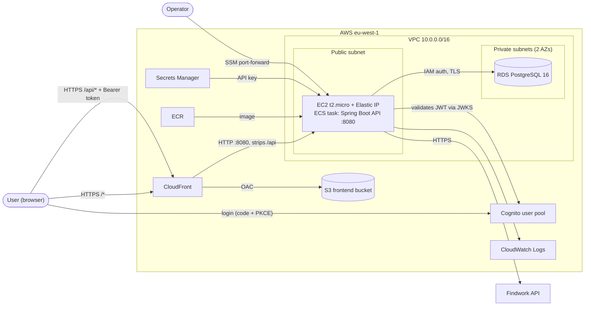

# Infrastructure

Everything runs in AWS `eu-west-1` (environment `dev`) and is defined with Terraform in two separate stacks:

| Stack | Location | Owns |
|---|---|---|
| **API** | `terraform/` (this repo) | Network, database, container platform, image registry, API secrets |
| **Backoffice** | `../jobscan-backoffice/terraform/` | Static site hosting, CDN, public access to the API, authentication |

The backoffice stack depends on the API stack: it reads the API stack's local state file (`api_state_path`, default `../../jobscan/terraform/terraform.tfstate`) to find the Auto Scaling group and VPC. **Apply the API stack first.**

## Overview

## Request flow

1. The browser loads the SPA from CloudFront (default behaviour, S3 origin, cached).
2. The SPA redirects to Cognito's hosted login (authorization code + PKCE) and receives tokens.
3. The SPA calls `https://<distribution>/api/...` with `Authorization: Bearer <access token>`.
4. CloudFront matches `/api/*` (caching disabled, all viewer headers except `Host` forwarded), a CloudFront Function strips the `/api` prefix, and the request goes over HTTP to the instance's Elastic IP on port 8080.
5. Because the SPA and the API share one origin, no CORS configuration is needed.

## API stack (`terraform/`)

| Component | Details |
|---|---|
| **VPC** | `10.0.0.0/16`, DNS support and hostnames on. One public subnet (`10.0.10.0/24`, AZ a) with an Internet Gateway route; two private subnets (AZ a and b) with no internet route. |
| **Compute** | ECS cluster on EC2. A launch template (`t2.micro`, ECS-optimised Amazon Linux 2023 AMI) in an Auto Scaling group fixed at 1 instance (min = max = 1). No load balancer. |
| **Service** | ECS service, 1 task, `bridge` networking, 512 CPU / 768 MiB memory. `deployment_minimum_healthy_percent = 0`, so a deploy stops the old task before starting the new one, with a brief outage. |
| **Image registry** | ECR `jobscan-dev`: mutable tags, scan on push, lifecycle policy keeps the last 5 images. Deployed tag is `container_image_tag` (default `latest`). |
| **Database** | RDS PostgreSQL 16, `db.t3.micro`, 20 GB gp2, encrypted, not publicly accessible, single AZ, 7-day backups. Master password is managed by RDS in Secrets Manager. IAM database authentication is enabled. |
| **DB access** | The app connects as `jobscan_app` with an IAM token (`jdbc:aws-wrapper:postgresql` with the `iam` plugin, `sslmode=require`). The user is created by hand once (see `README.md`). |
| **Secrets** | The Findwork API key lives in a Secrets Manager secret created outside Terraform (`findwork_api_key_secret_arn`) and is injected into the container as `FINDWORK_API_KEY`. |
| **Logs** | CloudWatch log group `/ecs/jobscan-dev`, 7-day retention. |

### Security groups

| Group | Inbound | Outbound |
|---|---|---|
| `jobscan-dev-sg` (`ecs_sg`) | None from this stack. The backoffice stack adds TCP 8080 from the CloudFront origin-facing prefix list. | All |
| `jobscan-app-sg` (`app`) | None | All |
| `jobscan-rds-sg` | TCP 5432 from `jobscan-app-sg` only | All |

The instance carries both `ecs_sg` and `app-sg`, which is how it reaches RDS.

### IAM roles

| Role | Used by | Permissions |
|---|---|---|
| `ecs-instance-role` | EC2 host | ECS agent policy, `AmazonSSMManagedInstanceCore` (for SSM sessions) |
| `task-execution-role` | ECS agent | Pull from ECR, write logs, `secretsmanager:GetSecretValue` on the Findwork secret |
| `app-task` | The running container | `rds-db:connect` as `jobscan_app` only |

## Backoffice stack (`../jobscan-backoffice/terraform/`)

| Component | Details |
|---|---|
| **S3 bucket** | Private frontend bucket. Only the CloudFront distribution may read it (bucket policy on `AWS:SourceArn`). |
| **CloudFront** | One distribution, default `*.cloudfront.net` certificate, `PriceClass_100`, redirects HTTP to HTTPS. Behaviours: default = S3 via Origin Access Control (SigV4, `CachingOptimized`); `/api/*` = API origin, HTTPS only, `CachingDisabled`, all methods allowed. |
| **API origin** | The instance's Elastic IP public DNS, plain HTTP on port 8080 (the CloudFront-to-origin hop is not encrypted). |
| **Elastic IP** | Gives CloudFront a stable origin name. It is attached to the ASG's current instance. If the ASG replaces the instance, re-run `terraform apply` to move it. |
| **Security group rule** | Lets only CloudFront's managed origin-facing prefix list reach port 8080 on the API instance. |
| **CloudFront Function** | Viewer-request function on `/api/*`. It rewrites `/api/job-postings` to `/job-postings`, and answers `403` to `POST /api/import-job-postings` without reaching the API. The path is decoded and normalised first (percent-encoding, repeated slashes, `;` parameters, trailing slash), and a malformed `POST` path is also rejected. |
| **Cognito** (`cognito.tf`) | See below. |

### Authentication (Cognito)

| Item | Setting |
|---|---|
| User pool | Email as username, admin-created users only (no self sign-up), 12+ character password with all classes, optional TOTP MFA (`cognito_mfa_configuration`), email account recovery. |
| App client `spa` | Public client with no secret. Authorization code grant only, scopes `openid email profile`, only the `COGNITO` identity provider. Callback/logout URLs are the CloudFront site plus `cognito_extra_redirect_urls` (default `http://localhost:5173/`). |
| Tokens | Access and ID tokens last 60 minutes, refresh token 7 days. Refresh-token rotation and revocation are enabled. |
| Hosted login domain | `jobscan-backoffice-dev.auth.eu-west-1.amazoncognito.com` (Cognito prefix domain). |
| Groups | `admin`, exposed to the API in the `cognito:groups` claim. |
| Outputs | `cognito_issuer_uri`, `cognito_spa_client_id`, `cognito_user_pool_id`, `cognito_login_domain`. |

**Status:** the Cognito resources are applied. The API validates tokens (`src/main/kotlin/org/ferran/jobscan/security/SecurityConfig.kt`):
- every endpoint needs a Cognito **access** token as `Authorization: Bearer <token>`, otherwise `401`;
- the token must have the pool as issuer (`COGNITO_ISSUER_URI`), `token_use = access`, and `client_id = COGNITO_SPA_CLIENT_ID`, because Cognito access tokens have no `aud` claim;
- `cognito:groups` become roles; `POST /import-job-postings` also needs the `admin` group, otherwise `403`.

The API stack passes both values to the task from `cognito_issuer_uri` and `cognito_spa_client_id` in `dev.tfvars`. Copy them from the backoffice outputs: they can't be read from its state, because that stack already reads the API's state. The remaining work is to wire the SPA to the hosted login and send the access token.

Create users with `aws cognito-idp admin-create-user` (or the console) and add them to the `admin` group.

## Operations

- **Deploy the API:** `scripts/build_push_docker_image.sh`, then `scripts/publish_docker_image.sh`, which forces a new ECS deployment and waits for it.
- **First-time setup:** `terraform apply -target=aws_ecr_repository.app`, push the image, then a full `terraform apply`. Always pass `-var-file=dev.tfvars` in the API stack.
- **Deploy the SPA:** upload the build to the `bucket_name` output, then invalidate the `distribution_id` output.
- **Direct API access:** an SSM port-forward to the instance (port 8080), or to RDS through the instance with `AWS-StartPortForwardingSessionToRemoteHost`. The instance has no SSH or public inbound rules except CloudFront's.
- **State:** both stacks use local state (the API's `terraform.tfstate` is git-ignored). Back it up, and note that the backoffice stack breaks if the API state file moves.

## Known limitations

- **Single instance, no load balancer:** deploys and instance replacement cause downtime, and the Elastic IP needs a manual `terraform apply` after a replacement.
- **Unencrypted CloudFront-to-origin hop:** bearer tokens cross it in plain HTTP inside AWS. Consider TLS on the origin.
- **Import endpoint:** `POST /import-job-postings` is blocked at CloudFront. Callers that reach the instance directly (for example through an SSM tunnel) need a token from the `admin` group.
- **Production hardening:** `deletion_protection = false`, `skip_final_snapshot = true`, single-AZ RDS, no WAF.
- **Stale architecture diagram:** `infrastructure-architecture.mmd` (and the one in `README.md`) predates the database connection and the backoffice stack, and still shows RDS as "not connected yet".
