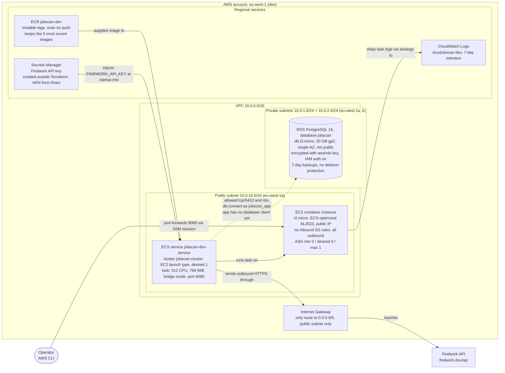

# jobscan

## Deploying a new version

Run these scripts locally to release a new version of the app. You can run them from any directory; the examples below run from the project root.

### 1. Push the Docker image to ECR

`scripts/build_push_docker_image.sh` builds the application image and pushes it to ECR with the `latest` tag:

```sh
scripts/build_push_docker_image.sh
```

### 2. Publish the image

Pushing the image doesn't update the running app. `scripts/publish_docker_image.sh` forces a new ECS deployment so the service starts the latest image, then waits until the deployment finishes:

```sh
scripts/publish_docker_image.sh
```

The API is briefly unavailable during the deployment, because the old task stops before the new one starts.

### Prerequisites

- Docker, Terraform and the AWS CLI are installed.
- You are logged in to AWS (`aws login`).
- Terraform has been initialized and the infrastructure exists. The first deployment has to create the ECR repository, push the image, and then create everything else, so run these instead of the steps above:

  ```sh
  terraform -chdir=terraform init
  terraform -chdir=terraform apply -var-file=dev.tfvars -target=aws_ecr_repository.app
  scripts/build_push_docker_image.sh
  terraform -chdir=terraform apply -var-file=dev.tfvars
  ```
- To open a tunnel to the ECS instance:

  1. Install the plugin (Ubuntu, x86_64):
```sh
curl -fsSL -o /tmp/session-manager-plugin.deb \
https://s3.amazonaws.com/session-manager-downloads/plugin/latest/ubuntu_64bit/session-manager-plugin.deb
sudo dpkg -i /tmp/session-manager-plugin.deb
session-manager-plugin --version
```

  2. Open the tunnel:
```sh
ASG=$(terraform -chdir=terraform output -raw asg_name)
INSTANCE_ID=$(aws ec2 describe-instances --region eu-west-1 \
--filters "Name=tag:aws:autoscaling:groupName,Values=$ASG" "Name=instance-state-name,Values=running" \
--query 'Reservations[0].Instances[0].InstanceId' --output text)

aws ssm start-session --region eu-west-1 --target "$INSTANCE_ID" \
--document-name AWS-StartPortForwardingSession \
--parameters '{"portNumber":["8080"],"localPortNumber":["8080"]}'
```

### Applying terraform changes
```sh
cd terraform
terraform apply -var-file=dev.tfvars
```

### To launch locally

```sh
docker build -t jobscan .
docker run --rm -p 8080:8080 --env-file .env.properties jobscan
```
The API is then available at http://localhost:8080. Press Ctrl+C to stop the container, and --rm removes it on exit.

## Architecture

Source: [`infrastructure-architecture.mmd`](infrastructure-architecture.mmd)


